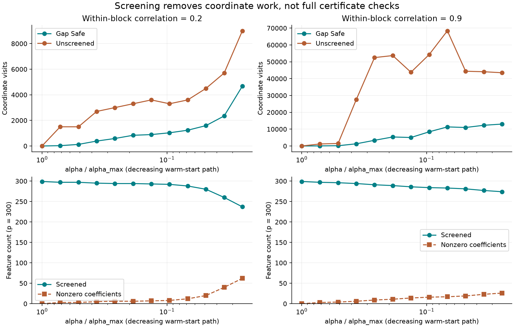
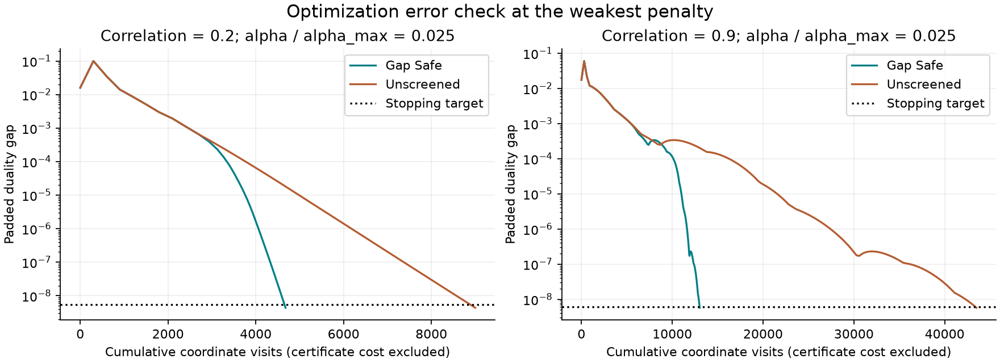

# Gap Safe Lasso Path

An original, educational dense NumPy Lasso solver with inspectable duality-gap
certificates, dynamic Gap Safe screening, and a warm-start regularization path.
It asks a concrete engineering question: **can we avoid updating irrelevant
features while still checking optimality against the entire problem?**

The experiment compares screened and unscreened coordinate descent at the same
stopping tolerance, checks both against scikit-learn, and records the certificate
work that screening does **not** remove. No private or downloaded data is used.
This is a portfolio implementation of established methods, not a new algorithm.

## Reproduce

Python 3.11 or later:

```bash
python3 -m venv .venv
source .venv/bin/activate
python -m pip install '.[test]'
python -m pytest -W error
OPENBLAS_NUM_THREADS=1 lasso-audit --output results
```

For the versions used to generate the committed results (Python 3.13):

```bash
python -m pip install -r requirements-repro.txt
python -m pip install --no-deps .
```

After editing the source, reinstall with `python -m pip install --no-deps .`.
The CLI emits `summary.json`, `traces.json`, and two PNGs. It raises if an
optimization does not converge, objective agreement fails, or a screened feature
is nonzero in the reference fit. GitHub Actions runs tests and the full experiment
on Python 3.11 and 3.13; it does not commit generated files or require secrets.

## Mathematical contract

For finite dense `X` of shape `(n, p)`, a vector `y`, and `alpha > 0`, solve

$$P(w)=\frac{\|y-Xw\|_2^2}{2n}+\alpha\|w\|_1.$$

There is no implicit intercept or standardization in the solver. The demo learns
both from training rows only. `alpha` matches scikit-learn's Lasso normalization;
the unnormalized penalty in the paper is $\lambda=n\alpha$.

The dual is

$$D(\theta)=y^T\theta-\frac n2\|\theta\|_2^2,
\qquad \|X^T\theta\|_\infty\leq\alpha.$$

Scale the current residual $r=y-Xw$ to obtain a feasible dual point. The gap
$G=P-D$ bounds primal suboptimality. Strong concavity places the optimal dual
point inside a ball of radius $\sqrt{2G/n}$ around $\theta$. Thus a feature is
safe to discard when

$$|X_j^T\theta|+\|X_j\|_2\sqrt{2G/n}<\alpha.$$

These are the spherical Gap Safe rules of
[Fercoq, Gramfort & Salmon (ICML 2015)](https://proceedings.mlr.press/v37/fercoq15.html),
adapted to the normalization above. Screening identifies coefficients zero in
the penalized optimum, not scientifically irrelevant variables or causal effects.

## Implementation decisions

- Cyclic coordinate updates use soft thresholding and an incremental residual.
  The residual is refreshed from `y - X @ w` after each sweep.
- Every certificate uses **all columns**, including screened ones. A certificate
  costs three full dense matrix-vector products: the residual and two correlation
  calculations. Screening only reduces subsequent coordinate visits.
- Avoid cancellation in `P-D` by evaluating the equivalent expression
  `||r-n*theta||²/(2*n) + sum(abs(w)*(alpha-sign(w)*(X.T@theta)))`.
- Move the dual point slightly inside the feasible region and check feasibility
  again. Add `64*eps*(n+p)*max(1, P, abs(D))` to the gap for stopping and screening;
  also use a strict screening margin. Both raw gap and padding are exposed.
  These are conservative floating-point safeguards, **not interval arithmetic
  or a formally verified numerical certificate**. Extreme scaling is unsupported;
  overflow and underflowed nonzero column norms raise instead of certifying a fit.
- Retain nonzero current coefficients even if a sphere could exclude them. This
  conservative choice screens a coordinate only once its current value is zero.
- Stop only if `gap_bound <= atol + rtol*||y||²/(2*n)`; small coefficient updates
  alone are not sufficient. Hitting the sweep limit raises `ConvergenceError`
  with an inspectable incomplete result.
- Zero columns are discarded algebraically. Duplicated columns are supported:
  coefficients need not be unique, so agreement is judged using objective values
  and fitted predictions rather than requiring identical coefficient vectors.
- Paths use strictly decreasing positive penalties and warm-start coefficients,
  but **reset all screening decisions at every new alpha**. A feature safely
  absent at one penalty can become nonzero at a weaker penalty.

## Synthetic experiment

Seed `20261013` generates 300 features in 30 independent blocks of ten. Each
standardized feature is `sqrt(rho)*block_factor + sqrt(1-rho)*independent_noise`.
Two paired scenarios use within-block correlation `rho = 0.2` and `0.9`.
The first feature in each of six blocks has coefficient
`[2, -1.8, 1.5, -1.3, 1, -0.8]`; Gaussian response noise has standard deviation
0.7. Feature-specific offsets and scales exercise the preprocessing code.

Of 800 independent rows, 240 train the model, 160 select the penalty, and 400
evaluate only the selected model. Feature means, unit-RMS scales, target mean,
and `alpha_max = max(abs(X.T@y))/n` use training data only. Constant training
columns use scale one. The target intercept is restored for predictions.
Twelve penalties range geometrically from `alpha_max` down to `0.025*alpha_max`.
Screened and unscreened solvers both use `rtol=1e-9`, `atol=1e-10`;
the independent scikit-learn implementation uses `tol=1e-12` and no intercept
on the already-centered inputs. Its stopping convention is documented
[here](https://scikit-learn.org/stable/modules/generated/sklearn.linear_model.Lasso.html).

Hyperparameter selection minimizes validation MSE. The model is **not refit** on
train plus validation, and no test rows are used to choose alpha. MSE is a
descriptive result on this single synthetic draw, not a population claim.

## Observed results

Full-path totals from [the committed JSON](results/summary.json):

| Within-block correlation | Unscreened coordinate visits | Gap Safe coordinate visits | Reduction | Full certificate matvecs, each solver | Selected test MSE |
| --- | ---: | ---: | ---: | ---: | ---: |
| 0.2 | 41,700 | 13,734 | 67.1% | 453 | 0.6507 |
| 0.9 | 435,000 | 71,402 | 83.6% | 4,386 | 0.6527 |

Both methods required the same number of sweeps in these runs. Screening saved
coordinate work, while full certificate work was unchanged. Counts exclude
preprocessing, reference fits, validation predictions, and plotting; these are
not end-to-end cost estimates or timings.

Across the 24 solutions, the largest absolute objective difference from
scikit-learn was `1.78e-15`, and the largest training-prediction difference was
`2.07e-7`. Objective agreement at machine precision is not exact equality of
coefficients. All padded gaps met their per-scenario targets, approximately
`5.51e-9` and `6.17e-9`, and no reference nonzero coefficient was screened.

Validation selected `alpha/alpha_max = 0.03496` for correlation 0.2 and `0.025`
for correlation 0.9. The latter is the bottom of the predeclared grid, not evidence
of a globally optimal penalty. The selected fits have 40 and 26 nonzero
coefficients despite only six nonzeros in the data-generating model: accurately
solving the Lasso is not equivalent to recovering the true support.

The known response-noise variance is 0.49; it is a population noise floor, not a
lower bound for one realized test-set MSE. Re-running the frozen environment
produces the same numeric JSON; cross-platform equality is tolerance-based.





## Small API example

```python
import numpy as np
from gap_safe_lasso import lasso_path
from gap_safe_lasso.preprocessing import TrainingScale

X = np.array([[1, 2], [2, 0], [3, 4], [4, 1]], dtype=float)
y = np.array([1, 2, 2, 4], dtype=float)
scale = TrainingScale.fit(X, y)
A, b = scale.transform(X), y - scale.target_mean
alpha_max = np.max(np.abs(A.T @ b)) / len(b)
results = lasso_path(A, b, alpha_max * np.array([1, 0.5, 0.1]))
last = results[-1]
raw_coef, intercept = scale.raw_parameters(last.coef)
print(last.certificate.gap_bound, last.certificate.kkt_violation)
print(X @ raw_coef + intercept)
```

## Validation and scope

Tests cover an orthogonal soft-threshold oracle; dual feasibility, the gap
identity, and the dual ball; multiple correlation/penalty combinations against
scikit-learn; screened-versus-unscreened agreement; the all-zero solution at
`alpha_max`; zero and duplicated columns; re-entry after a penalty change;
explicit non-convergence; trace/work accounting; non-mutation of warm starts;
column permutation/sign invariance; training-only preprocessing and restored
intercepts; deterministic data generation; and invalid or unrepresentable inputs.

This is deliberately a small dense float64 implementation, not a competitor to
compiled production solvers. It excludes sparse matrices, sample weights,
multi-output models, positivity constraints, generalized losses, and out-of-core
data. Full certificates, Python loops, and trace storage impose overhead.
Coordinate-visit reductions are **not wall-clock speedups**; timings are not
reported. Screening can be less effective at weak penalties or near dual
boundaries. A small optimization gap does not guarantee recovery of the true
support, generalization, uncertainty calibration, or valid causal inference.

The raw-scale penalty is weighted implicitly by the training feature scales;
it is not the same objective as applying an unweighted Lasso to unscaled data.
Changing BLAS, library versions, or operating system may alter last-bit results,
iteration counts, and near-boundary screening decisions. Reference checks use
tolerances for this reason. The frozen environment is a reproduction aid, not a
universal cross-platform lockfile.

Code is original to this repository; mathematical ideas are attributed above.
MIT licensed. No personal records, market returns, or employment claims are used.
